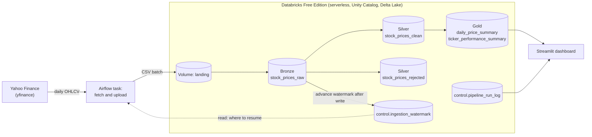
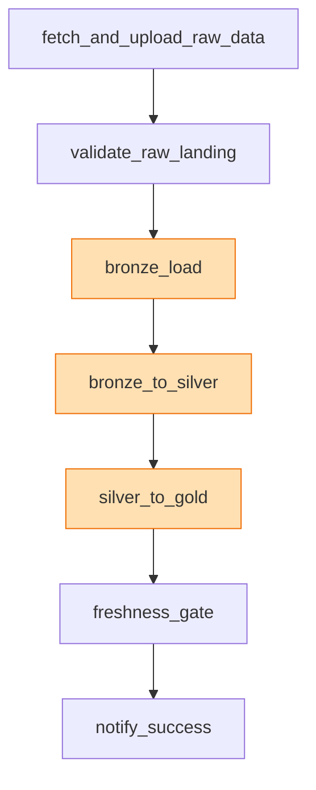

# Finance Lakehouse

[](https://github.com/mihirshinde199/finance-lakehouse-de/actions/workflows/ci.yml)


A daily batch data pipeline that ingests market data for a fixed basket of 12 tickers from Yahoo Finance, refines it through a Bronze / Silver / Gold lakehouse on Databricks, and serves it through a Streamlit dashboard. Airflow orchestrates the run, and everything runs on free tiers.

## Highlights

- **Medallion architecture on Delta Lake:** raw, cleaned and aggregated layers with a clear write strategy for each (append-only, `MERGE`, windowed overwrite).
- **Incremental and idempotent:** a per-ticker watermark drives ingestion, and every task is safe to re-run without creating duplicates.
- **Data quality built in:** row-level validation with a quarantine table for rejected rows, a batch-level rejection threshold, and a freshness gate that fails the run when data goes stale.
- **Observable:** every notebook logs row counts and durations to a control table, and the dashboard has a pipeline-health view built on it.
- **Orchestrated like production:** Airflow in Docker triggers Databricks jobs through the Jobs API on serverless compute, with retries, backoff and failure alerts.
- **Free tools only:** Databricks Free Edition, Airflow in Docker, GitHub Actions and Streamlit.

## Screenshots


## Architecture



The DAG runs daily (`@daily`, `catchup=False`). The three orange tasks submit Databricks notebooks through the Jobs API.



Retries: the fetch task retries 3 times with exponential backoff (the source API is the flakiest dependency), and the Databricks tasks retry twice with a fixed delay. The freshness gate does not retry, because a failed gate is a signal and not a transient error. Any failure triggers an optional Slack alert.

## Data model

| Layer | Table | Key / grain | Write strategy | Purpose |
|---|---|---|---|---|
| Bronze | `bronze.stock_prices_raw` | one row per ticker-day per load | append-only, partitioned by `ingestion_date` | Raw landing with lineage (`source_file`, `batch_id`) |
| Silver | `silver.stock_prices_clean` | `(ticker, trade_date)` | `MERGE` | Typed, deduplicated, validated, with `daily_return` |
| Silver | `silver.stock_prices_rejected` | rows that failed validation | append-only quarantine | Nothing is silently dropped; each row has a failure reason |
| Gold | `gold.daily_price_summary` | `(ticker, trade_date)` | windowed overwrite of the trailing 90 trading days | SMA-20, SMA-50, 20-day volatility, 20-day average volume |
| Gold | `gold.ticker_performance_summary` | `(ticker, as_of_date)` | `MERGE` | YTD return, max drawdown, average daily volume |
| Control | `control.ingestion_watermark` | one row per ticker | `MERGE`, written only by the Bronze notebook | Incremental ingestion state |
| Control | `control.pipeline_run_log` | one row per stage per run | append | Row counts, duration and status for each run |

The full column list is in [`docs/data_dictionary.md`](docs/data_dictionary.md).

## Key design decisions

- **`(ticker, trade_date)` is the business key from Silver onward.** Exchanges publish one record per symbol per session, so dedup, `MERGE` and the Gold recompute all key on it.
- **Each layer gets the write strategy that fits it.** Bronze is a log, so it only appends. Silver is a keyed fact table, so it uses `MERGE`. Gold's rolling metrics depend on trailing rows, so it recomputes the window and replaces it. Re-running any stage is safe.
- **The watermark advances only after a successful write.** The fetch task only reads it. The Bronze notebook updates it after the data has landed, so a failed load is retried automatically on the next run. The fetch also re-pulls the 5 days before the watermark, which absorbs late corrections from the source.
- **Orchestration and compute are separate.** Airflow schedules, retries and alerts. PySpark runs in Databricks. Airflow lives in its own Docker image because its pinned dependency tree conflicts with the rest of the project.
- **Rejected rows are quarantined, not dropped.** Rows with an invalid date, a missing ticker or close, or inconsistent prices (`high < low`, or a high or low outside the open and close) go to `silver.stock_prices_rejected` with a reason. A negative volume is nulled and the row is kept.
- **Gates fail loudly.** If more than 5% of a batch is rejected, the Silver job fails. The final `freshness_gate` task fails the run if the newest Gold trade date is more than 5 days old or the watermark table is not exactly one row per configured ticker. A pipeline that finishes green while loading nothing is worse than one that fails.
- **No partitioning on Silver or Gold.** At roughly 11.5k rows it would only create many tiny files. Bronze is partitioned by ingestion date to make replays cheap.
- **Least-privilege credentials.** One token (SQL and files scopes) serves ingestion and the dashboard, and a separate jobs-scoped token lives in the Airflow connection. Secrets exist only in `.env` (gitignored) and the Airflow connection.

## Dashboard

`dashboard/app.py` is a Streamlit app that queries the Gold tables and the run log live through Databricks SQL, with a 5-minute cache.

- **Prices:** latest close, SMA-20, SMA-50 and volatility for a chosen ticker, with price, volatility and volume charts.
- **Performance:** YTD return and max drawdown across all 12 tickers.
- **Pipeline health:** a fresh or stale banner, the last run per stage, run durations over time, recent runs and the watermark table.

## Tech stack

Python 3.11, PySpark, Delta Lake, Databricks Free Edition (serverless, Unity Catalog), Apache Airflow 2.9 (Docker, LocalExecutor, Postgres), yfinance, Streamlit with Altair, `databricks-sql-connector`, `databricks-sdk`, GitHub Actions, ruff and pytest.

## Repository layout

```
.
├── dags/finance_pipeline_dag.py     # Airflow DAG
├── notebooks/                       # Databricks notebooks, run via the Jobs API
│   ├── 01_bronze_load.py
│   ├── 02_bronze_to_silver.py
│   └── 03_silver_to_gold.py
├── src/
│   ├── ingestion/fetch_yfinance.py  # watermark-driven fetch
│   └── config/tickers.yaml          # ticker basket and ingestion settings
├── dashboard/app.py                 # Streamlit dashboard
├── docs/                            # architecture, data dictionary, project guide
├── tests/
├── docker-compose.yml               # Airflow webserver, scheduler and Postgres
└── .github/workflows/ci.yml         # ruff and pytest on every PR and push to main
```

## Getting started

**Prerequisites:** Docker Desktop, Python **3.11** (the pinned pandas fails to install on newer versions), and a Databricks Free Edition workspace.

**1. Install and configure**

```bash
git clone https://github.com/mihirshinde199/finance-lakehouse-de.git
cd finance-lakehouse-de
python3.11 -m venv .venv
source .venv/bin/activate        # Windows: .venv\Scripts\Activate.ps1
pip install -r requirements.txt
cp .env.example .env
```

Fill in `.env`:

```
DATABRICKS_SERVER_HOSTNAME=your-workspace.cloud.databricks.com
DATABRICKS_HTTP_PATH=/sql/1.0/warehouses/your-warehouse-id
DATABRICKS_TOKEN=your-token-here     # scopes: sql, files
SLACK_WEBHOOK_URL=                   # optional, enables failure alerts
```

The hostname and HTTP path are on the SQL warehouse's Connection details tab. Create the token under Settings, then Developer, then Access tokens.

**2. Prepare Databricks**

Run this once in a notebook or the SQL editor. The Bronze, Silver and Gold schemas and tables are created by the notebooks on their first run. Leave the watermark table empty, because the first run backfills from the start date in `src/config/tickers.yaml`.

```sql
CREATE SCHEMA IF NOT EXISTS control;

CREATE TABLE IF NOT EXISTS control.ingestion_watermark (
  ticker STRING NOT NULL,
  last_successful_trade_date DATE,
  last_run_timestamp TIMESTAMP
) USING DELTA;

CREATE TABLE IF NOT EXISTS control.pipeline_run_log (
  run_id STRING, stage STRING,
  rows_in LONG, rows_out LONG, rows_rejected LONG,
  started_at TIMESTAMP, ended_at TIMESTAMP, status STRING
) USING DELTA;

CREATE VOLUME IF NOT EXISTS workspace.default.landing;
```

Then import the three notebooks from `notebooks/` into your workspace and set their paths in the `WORKSPACE_NOTEBOOK_PATH_*` constants at the top of `dags/finance_pipeline_dag.py`.

**3. Start Airflow**

```bash
docker-compose up
```

The first start takes a few minutes because the containers install the Databricks provider and the other Python packages. Then:

1. Open http://localhost:8080 and sign in with `airflow` / `airflow` (local development only).
2. Go to Admin, then Connections, and add a connection with ID `databricks_default`, type `Databricks`, your workspace hostname as Host, and a token with the **`jobs`** scope as Password.
3. Unpause `finance_pipeline_dag` and trigger it.

**4. Check the result**

```sql
SELECT * FROM control.pipeline_run_log ORDER BY started_at DESC;
```

A healthy run logs one row each for `bronze`, `silver` and `gold`.

**5. Run the dashboard**

```bash
streamlit run dashboard/app.py
```

## Testing and CI

GitHub Actions runs `ruff` and `pytest` on every pull request and every push to `main`. Data quality and idempotency are also enforced inside the pipeline itself, through the row-level rules, the 5% rejection threshold and the freshness gate, not only in CI.

## Challenges solved

- **A green DAG that loaded nothing.** For weeks every run succeeded while the Bronze job kept reloading an old, hard-coded batch. The run log exposed it: the same batch ID and constant row counts. The fix was to make `batch_id` a required job parameter that fails loudly when missing, and to add the freshness gate so staleness can never pass silently.
- **Serverless job submission.** Databricks Free Edition rejects any cluster specification. Jobs have to be submitted with the `tasks` array format and no cluster at all.
- **Token scope failures.** Three separate failures (SQL, Files, Jobs) led to purpose-specific, least-privilege tokens.
- **Duplicate watermark rows.** `DESCRIBE HISTORY` traced them to non-idempotent manual setup cells, not to the pipeline: the Bronze `MERGE` had inserted zero rows on every run since the first. The table was rewritten as one row per ticker, and the freshness gate now checks for it.
- **Unity Catalog and Delta restrictions.** `input_file_name()` is unsupported (use `_metadata.file_path`), and Delta `DELETE` rejects multi-column `IN` predicates (use `MERGE ... WHEN MATCHED THEN DELETE`).
- **Dependency conflicts.** Airflow's provider pins (`databricks-sql-connector<3`, `pandas<2.2`) conflict with the local stack, so the Airflow container and the local environment use separately pinned versions.
- **Source API drift.** yfinance returned empty data until it was upgraded, and its multi-level column headers had to be flattened before writing CSVs.

## Limitations and next steps

- Airflow runs locally in Docker because hosted Airflow is paid, and notebooks are deployed to Databricks by hand. A natural next step is CD with GitHub Actions and the Databricks Jobs API.
- Batch only, once a day. There is no streaming path.
- Validation rules are hand-written in PySpark. A framework such as Great Expectations would make them declarative.
- A public demo would need a snapshot-based dashboard so that no credentials are hosted.
- A forecasting layer on the Gold features (`sma_20`, `volatility_20d`) is planned as a second version.

## Data and disclaimer

Prices come from Yahoo Finance through the `yfinance` library and are used here for educational purposes. Nothing in this project is financial advice.

## License

MIT. See [LICENSE](LICENSE).
